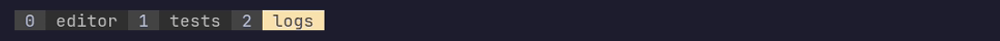
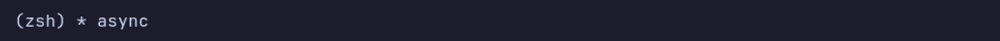
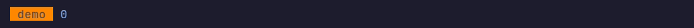
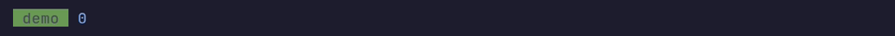
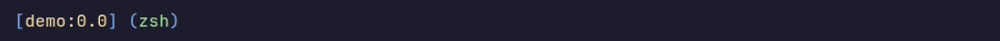
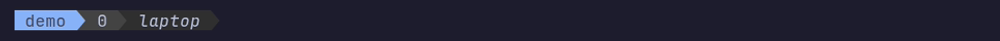
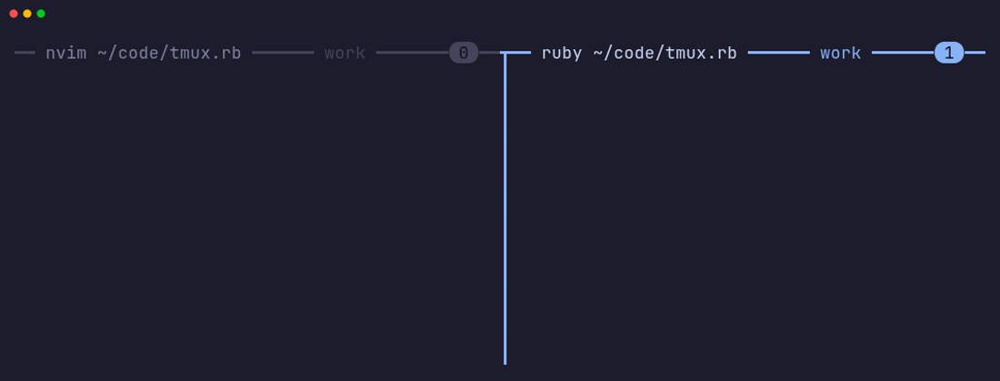

# tmux.rb

tmux.rb is a Ruby DSL that compiles readable, structured block-based
configuration into native tmux configuration and format strings.

## At a glance

A small, hand-written `~/.tmux.conf`:

<!-- glance: tmux -->
```tmux
set -g prefix C-a
unbind C-b
bind C-a send-prefix

set -g mouse on
set -g base-index 1
setw -g mode-keys vi

bind | split-window -h -c "#{pane_current_path}"
bind - split-window -v -c "#{pane_current_path}"
bind r source-file ~/.tmux.conf \; display-message "Reloaded"

set -g status-right "#{?window_zoomed_flag,#[fg=yellow]ZOOM #[fg=default],}#S"
```

The same configuration in tmux.rb, which compiles to a file tmux loads
identically:

<!-- glance: ruby -->
```ruby
Tmux.configure do
  global.prefix = "C-a"
  unbind "C-b"
  bind("C-a").command(:send_prefix)

  global.mouse = true
  global.base_index = 1
  window.mode_keys = :vi

  bind("|").split(:horizontal, cwd: :current)
  bind("-").split(:vertical, cwd: :current)
  bind("r").source("~/.tmux.conf").display_message("Reloaded")

  global.status.right = Tmux.format do
    if?(Tmux.window_zoomed_flag) { style(fg: :yellow) { text "ZOOM " } }
    text Tmux.session_name
  end
end
```

The payoff grows with the configuration. Status lines are where hand-written
tmux gets hardest to read, and where the format DSL helps most:

<!-- example: intro -->
```ruby
# ~/.config/tmux/tmux.rb
Tmux.configure do
  global.prefix = "C-s"     # set-option -g prefix "C-s"
  global.mouse = true       # set-option -g mouse on
  window.mode_keys = :vi    # set-option -gw mode-keys "vi"

  global.status.right = Tmux.format do
    if?(Tmux.window_zoomed_flag) do
        left_flag "Z", bg: :white, fg: :black, attrs: :bold
    end
    left_segment Tmux.pane_current_command, bg: :colour238, fg: :white
    left_segment "#{Tmux.session_name}@#{Tmux.host}", bg: :blue, fg: :black
  end

  bind("|").split(:horizontal, cwd: :current)
end
```

```bash
tmux.rb build ~/.config/tmux/tmux.rb --output ~/.tmux.conf
```

<details>
<summary>Screenshot: the status line this configuration draws, in a zoomed window</summary>


</details>

Screenshots in this README are real tmux sessions rendering the example just
above them ([how they are made](docs/screenshots/README.md)). They use the
**Catppuccin Mocha** terminal color scheme and JetBrains Mono Nerd Font, with
the status bar set to the terminal's own colors. Named colors such as `:blue`,
`:white`, or `colour1` take their shade from your terminal's color scheme;
`colour16` to `colour255` and hex colors such as `"#ff8800"` look the same
everywhere. Powerline edges need a font with Powerline glyphs, such as a
[Nerd Font](https://www.nerdfonts.com).

## Examples

- [examples/author_config.rb](https://github.com/cosmicbuffalo/tmux.rb/blob/main/examples/author_config.rb)
  is the author's complete tmux configuration: structured status bars, pane
  borders, and window tabs, plus integration with
  [tmux-ai-attn](https://github.com/cosmicbuffalo/tmux-ai-attn).
- [examples/popular_configs](https://github.com/cosmicbuffalo/tmux.rb/blob/main/examples/popular_configs/README.md)
  contains ten ports of well-known public tmux configurations. Each pinned
  upstream config sits beside its Ruby version for comparison.
- [examples/window_status.rb](https://github.com/cosmicbuffalo/tmux.rb/blob/main/examples/window_status.rb)
  is a standalone format file.

## Why

Hand-written tmux configuration gets hard to change once it grows: status
lines become deeply nested `#{?...,...,...}` expressions where a misplaced
comma silently breaks rendering, and every level of quoting has to be escaped
by hand. tmux.rb keeps tmux's model but lets you write it as ordinary Ruby.

- **Compile, don't interpret.** Ruby runs only while you build or validate a
  configuration. The output is plain tmux configuration, and tmux evaluates
  its own formats, so rendering the status line never spawns Ruby and needs
  nothing installed beyond tmux.
- **Skip manual escaping.** Write text, styles, variables, and conditionals
  directly, without managing nested tmux quoting and escaping.
- **Keep tmux within reach.** The DSL adds readable names and helpers but
  hides nothing: any option, command, or format string can still be written
  directly, and `raw` passes tmux commands through verbatim.
- **Generate deterministic output.** The same source always produces
  byte-identical configuration, so the generated file is easy to review and
  compare in version control.
- **Treat the live server as a boundary.** `build`, `check`, and `diff` never
  touch a running tmux server; only an explicit `load` does.

## Installation

```bash
gem install tmux
```

tmux.rb needs Ruby 3.2 or newer. The full DSL is tested on tmux 3.2 and newer.
Compilation requires the target tmux executable to be installed.

The gem installs the `tmux.rb` command (also available as `tmux_rb`). Ruby
code that uses the library directly loads it with `require "tmux"`.

## Configuration files

`Tmux.configure` builds configuration commands: option setters, key bindings,
and other tmux commands. `Tmux.format` builds one reusable value, such as the
contents of `status-right`, which those commands can assign to an option.

A configuration file ends with either resulting object (`Tmux::Config` or
`Tmux::Format`). Run it with the `tmux.rb` command, or use
`Tmux.load_file("config.rb")` from Ruby. Constants and helper methods defined
at the top level stay local to that file.

**Configuration files are trusted code.** `build`, `check`, `diff`, and
`load` all execute them, with the same access as a Ruby script. Only build
configurations you would be willing to run as a script. A binding created
with `load_config` re-runs its Ruby file every time the key is pressed.

### Blocks and helper methods

Inside `Tmux.configure` and `Tmux.format` blocks, call DSL methods directly.
Methods you `def` and instance variables you set in a block stay visible in
its nested blocks, including conditional branches. Local variables and
lambdas work throughout the blocks too.

Give a block one parameter to keep Ruby's normal scoping, with the builder
passed in:

```ruby
def status_color = "colour37"

Tmux.configure do |c|
  # self is unchanged here, so status_color is the method defined above.
  c.global.status.style = "fg=#{status_color}" # set-option -g status-style "fg=colour37"
end
```

## CLI

```bash
tmux.rb build config.rb                    # print the generated configuration
tmux.rb build config.rb --output tmux.conf # write it atomically
tmux.rb check config.rb                    # ask an isolated tmux server to parse it
tmux.rb diff  config.rb ~/.tmux.conf       # unified diff; exit 0 means identical
tmux.rb load  config.rb                    # compile and source into a tmux server
tmux.rb load  -S /tmp/outer.sock config.rb # ...into the server at a socket path
tmux.rb load  -L work config.rb            # ...or the server with a socket name
tmux.rb --version
```

Every command accepts `--help`.

- **`build --output`** updates the destination atomically. A
  symlinked destination (such as a `~/.tmux.conf` that points into a dotfiles
  repository) is followed rather than replaced, and an existing file keeps
  its permissions.
- **`check`** checks tmux syntax in an isolated server, including commands
  inside `if?` branches. Option names and scopes are already checked
  during compilation. It does not apply commands or validate option values.
  Loading the file into an isolated server checks values too:
  `tmux -L scratch -f /dev/null new-session -d 'sleep 600'`, then
  `tmux -L scratch source-file tmux.conf`.
- **`load`** sources the result into the server `$TMUX` names, or into the
  one given with `-S SOCKET` or `-L NAME`. Pass one of those from inside a
  nested tmux, where `$TMUX` names the inner server.

Errors raised while evaluating a configuration are reported with the file and
line that caused them.

### Target tmux version

By default, configurations target the `tmux` on your `PATH`. All built-in
option names and scopes are checked against that executable's supported
options. To build for a different version, select its executable with
`--tmux`:

```bash
tmux.rb build config.rb --tmux /opt/tmux-3.3/bin/tmux
tmux.rb check config.rb --tmux /opt/tmux-3.3/bin/tmux
tmux.rb load -S /tmp/outer.sock config.rb --tmux /opt/tmux-3.3/bin/tmux
```

From Ruby, use `Tmux.load_file("config.rb", tmux: "/opt/tmux-3.3/bin/tmux")`
or `Tmux.configure(tmux: "/opt/tmux-3.3/bin/tmux") { ... }`.
`load` refuses to apply a configuration if the destination server's version
does not match the selected executable. Use `tmux_from` and `tmux_below` for
settings that differ between versions; only the applicable version branch's
options are checked.

## Format DSL

Use `Tmux.format` for status lines, window tabs, pane borders, and anywhere
else tmux expands formats. [Assign the resulting format to an option](#format-valued-options)
to use it in a configuration:

<!-- example: window-tab -->
```ruby
# A window tab: the index in a colored block, then the name, which turns
# yellow while a flash is lit.
flash = Tmux.user_option(:@attn_flash)
phase = Tmux.user_option(:@attn_phase)

Tmux.format do
  # Set the foreground and background for what follows.
  style fg: :white, bg: :colour238
  # Literal text with the window index interpolated; it stays dynamic.
  text " #{Tmux.window_index} "
  # The name's colors: black on yellow while flashing, grey otherwise.
  if?(flash && phase) do
    style fg: :black, bg: :yellow
  end.else do
    style fg: :colour250, bg: :colour236
  end
  # The window name, padded with a space on each side.
  text " #{Tmux.window_name} "
  # Return to the default style so nothing leaks into the next tab.
  reset_style
end
```

<details>
<summary>Screenshot: three windows drawn with this format, the last one mid-flash</summary>



</details>

The sections below cover each part of the format DSL. Most calls can be
chained; `if?` supports `.elsif?` and `.else` branches.

### Text

`text` adds text that tmux shows as written. Expressions interpolated into the
string stay dynamic. Other characters, including `#`, `%`, `,`, and `}`,
print literally, even inside conditional branches.

```ruby
Tmux.format do
  # " 3 " for window 3: the interpolated index stays a tmux variable.
  text " #{Tmux.window_index} "
  # Expressions can also be passed as separate parts.
  text "[", Tmux.session_name, "]"
  # "#", "%", and "," print literally, even inside a conditional.
  if?(Tmux.pane_active) { text "#1, 50%" }
  # literal: true prints a string exactly as written, format code included.
  text "\#{not_a_variable}", literal: true
end
```

`text` rejects `#[` and `#(` in a string, since styles and shell commands
have their own methods (`style` and `command`).

### Dates and times

`strftime` adds a date/time format that tmux expands each time it renders.
Unlike `text`, its `%` codes are kept.

```ruby
Tmux.format do
  # "Tue 14:05", refreshed with the status line.
  strftime "%a %H:%M"
end
```

### Appending expressions, formats, and format code

`append` adds tmux format source as is: an expression, a format built
elsewhere, or a string of tmux format code. Unlike `text`, a
string given to `append` is format code, not literal text.

```ruby
clock = Tmux.format { strftime "%H:%M" }

Tmux.format do
  # An expression.
  append Tmux.pane_current_path
  # Another format.
  append clock
  # Raw tmux format code, for anything the DSL has no helper for.
  append "\#{t:window_activity}"
end
```

### Shell commands

`command` adds a `#(...)` shell command, which tmux runs in the background and
replaces with its output. Its text is format source, so `#{...}` codes expand
before the shell sees it. Commands must have balanced parentheses.

```ruby
Tmux.format do
  # The current git branch of the active pane's directory.
  command "git -C \#{pane_current_path} branch --show-current"
end
```

### Styles

`style` sets colors and attributes for what follows; `reset_style` returns to
the default. Given a block, `style` applies only to the block's content,
which `p:` pads with spaces on both sides, and the style from before the
block returns after it.

<!-- example: styles -->
```ruby
Tmux.format do
  # Colors and attributes as a hash.
  style fg: "#000000", bg: "#ff0000", attrs: :bold
  text " warning "
  # Attribute names alone.
  style :nobold
  # A styled, padded block: the window index in white on blue.
  style(fg: "#ffffff", bg: :blue, p: 1) do
    append Tmux.window_index
  end
  # After the block, the black on red from before it returns.
  text " here "
  # Back to the default style.
  reset_style
end
```

<details>
<summary>Screenshot: this format in the status line</summary>


</details>

### Conditionals

`if?` chooses content each time tmux renders. It includes its block when the
condition is true; use `!` to negate a condition.
Chain `.else` on `if?` for the false branch, or omit it to emit nothing when
false. Add `.elsif?(condition)` for more branches; the first matching branch
wins. Every branch can contain any format DSL calls, including nested
conditionals.

See [Expressions and conditions](#expressions-and-conditions) for variables,
comparisons, and combining tests with `&&`, `||`, and `!`. The same tests
work in configuration conditionals.

<!-- example: conditionals -->
```ruby
Tmux.format do
  # Show "(name)" when the window is zoomed, the plain name otherwise.
  if?(Tmux.window_zoomed_flag) do
    text "(#{Tmux.window_name})"
  end.else do
    append Tmux.window_name
  end
  # Show a marker unless the pane is in a mode (copy mode, for example).
  if?(!Tmux.pane_in_mode) { text " *" }
  # Show " sync" first, otherwise " mode" in copy mode, or " async".
  if?(Tmux.pane_synchronized) do
    text " sync"
  end.elsif?(Tmux.pane_in_mode) do
    text " mode"
  end.else do
    text " async"
  end
end
```

<details>
<summary>Screenshot: this format in a zoomed window</summary>



</details>

Outside a format block, `Tmux.if?` builds a reusable conditional format with
the same `.elsif?` and `.else` chain. Its branches use the format DSL; assign
the result to an option or `append` it inside another format:

```ruby
label = Tmux.if?(Tmux.pane_in_mode) do
  text "copy"
end.elsif?(Tmux.client_prefix) do
  text "prefix"
end.else do
  text "normal"
end

Tmux.configure do
  global.status.left = label
  global.status.right = Tmux.format do
    text "["
    append label
    text "]"
  end
end
```

### Value and style switches

Use a [conditional chain](#conditionals) to choose which format DSL calls
run. Use `switch` to choose a value to pass to a call, such as a color for
`fg:` or `bg:`. The returned expression can be reused across styles or formats.

Call `switch` inside `Tmux.format` or `Tmux.configure` blocks, or
`Tmux.switch` outside them. Both calls build the same kind of expression;
choosing a value does not itself add content or configuration commands.

Both choose the first matching condition when tmux renders. A switch
requires an `else:` value; a conditional chain can omit `.else` to emit
nothing when no condition matches.

`switch_style` chooses a set of style attributes for the content that follows.
It takes the same mapping as `switch`, with style hashes as the choices, and
is shorthand for a conditional chain whose branches only call `style`.

<!-- example: switch -->
```ruby
Tmux.format do
  # Orange while the prefix key is held, green in copy mode, grey otherwise.
  background = switch(
    Tmux.client_prefix => "#FF8800",
    Tmux.pane_in_mode => "#6A9955",
    else: "#A6ADC8"
  )
  # Use that color as a background.
  style(fg: :black, bg: background, p: 1) { append Tmux.session_name }
  # Back to the default style, then a space.
  reset_style
  text " "
  # Choose an entire style: red when input is off, blue otherwise.
  switch_style(Tmux.pane_input_off => {fg: :red}, else: {fg: :blue})
  text "#{Tmux.pane_index}"
end
```

`switch` values can contain tmux format code. For literal text, use `text`
inside a conditional branch instead.

<details>
<summary>Screenshot: this format with pane input disabled, with the prefix held, and in copy mode</summary>






</details>

### Wrapping

`wrap` surrounds a block's content with a prefix and suffix. The suffix is
drawn in the style that was active before the block, even if the block
changed it, including a style chosen by `switch_style`.

<!-- example: wrap -->
```ruby
Tmux.format do
  switch_style(Tmux.pane_input_off => {fg: :red}, else: {fg: :blue})
  # Yellow "session:window.pane", with brackets in the selected color.
  wrap "[", "]" do
    style fg: :yellow
    text "#{Tmux.session_name}:#{Tmux.window_index}."
    # Highlight only the pane number while the prefix is held.
    if?(Tmux.client_prefix) { style fg: :white }
    append Tmux.pane_index
  end
  # A template lambda receives a placeholder for the green command name.
  wrap ->(content) { " (#{content}) " } do
    style fg: :green
    append Tmux.pane_current_command
  end
end
```

<details>
<summary>Screenshot: this format in the status line</summary>



</details>

### Powerline helpers

Flags, segments, and chips draw Powerline-style blocks with their edge glyphs
and color transitions. Their content can be a string (with interpolated
expressions), an expression, or an array mixing the two; a block draws custom
content instead.

- `left_segment` / `right_segment`: adjoining blocks with one pointed edge.
  `left_segment` draws its edge over the previous block's background
  automatically. For `right_segment`, set `over:` to the next block's
  background to join the blocks without gaps.
- `left_flag` / `right_flag`: a self-contained badge, pointed at one end and
  notched at the other. `over:` sets the background behind the point;
  `notch_over:` can set a different background for the notch. If omitted,
  the notch uses the same background as the point.
- `chip`: a floating block with an edge on each side. When both edges are thin,
  `bg:` colors the outline and text, and `over:` sets the shared background
  behind the edges and content (default `:default`). `fg:` sets the text color
  for chips with solid edges.
- `p:` sets the padding spaces on each side (default 1); `attrs:` styles the
  content.
- `left:` and `right:` choose a chip's edge shapes: `:triangle` (the default),
  `:thin`, `:round`, `:round_thin`, `:rslant` (`/`), or `:lslant` (`\`).
  The keyword supplies the side, so `left: :round, right: :round` makes a
  rounded chip. Using the same slant on both sides makes a parallelogram;
  the two slants can also be mixed.
- `glyph:` accepts the same shapes for flags and segments, using the helper's
  `left_` or `right_` direction. Exact names from `Tmux::Glyph` and literal
  glyph strings are also accepted when you want a specific character.

`left_` helpers point left, for the right side of the status line; `right_`
helpers point right, for the left side:

<!-- example: status-right -->
```ruby
# status-right: blocks chained from right to left.
Tmux.format do
  # Path (with the home directory shortened to ~), then command; each edge
  # is drawn over the previous block's color.
  left_segment Tmux.pane_current_path.substitute("^#{Dir.home}", "~"), bg: :colour236, fg: :white
  left_segment Tmux.pane_current_command, bg: :colour238, fg: :white
end
```

<details>
<summary>Screenshot: this format as status-right</summary>


</details>

<!-- example: status-left -->
```ruby
# status-left: blocks chained from left to right.
Tmux.format do
  # Each edge sits over the next block's background for a continuous chain.
  right_segment Tmux.session_name, bg: :blue, fg: :black, over: :colour238
  # Content as a keyword, with its padding supplied by the string.
  right_segment content: " #{Tmux.window_index} ", bg: :colour238, fg: :white, p: 0, over: :colour236
  # The final edge meets the default background; only the text is italic.
  right_flag(bg: :colour236, fg: :white, over: :default, attrs: :italics, close: false) do
    text " #{Tmux.host_short} "
  end
end
```

<details>
<summary>Screenshot: this format as status-left</summary>



</details>

<!-- example: chips -->
```ruby
Tmux.format do
  # A chip with the default triangle edges...
  chip "default", bg: :blue, fg: :black
  text " "
  # ...rounded edges...
  chip "round", bg: :magenta, fg: :black, left: :round, right: :round
  text " "
  # ...thin edges and cyan text, all on the default background...
  chip "thin", bg: :cyan, fg: :black, left: :thin, right: :thin
  text " "
  # ...and slants leaning right or left, with the side inferred for each edge.
  chip "rslant", bg: :yellow, fg: :black, left: :rslant, right: :rslant
  text " "
  chip "lslant", bg: :green, fg: :black, left: :lslant, right: :lslant
end
```

<details>
<summary>Screenshot: these chips in the status line</summary>


</details>

### Zones

`Tmux.pane_border` builds a format from left, centre, and right zones, in
that order whatever order they are defined in. Each zone is an ordinary
format block.

<!-- example: zones -->
```ruby
Tmux.configure do
  global.status = false
  # Heavy pane borders with a label along the top, the active one in blue.
  window.pane.border.status = :top
  window.pane.border.lines = :heavy
  window.pane.border.style = {fg: "#45475a"}
  window.pane.active_border.style = {fg: "#89b4fa"}

  active = Tmux.pane_active
  accent = switch(active => "#89b4fa", else: "#45475a")
  window.pane.border.format = Tmux.pane_border do
    # The command and directory on the left, brighter on the active pane...
    left do
      style(fg: switch(active => "#cdd6f4", else: "#7f849c"), p: 1) do
        text "#{Tmux.pane_current_command} #{Tmux.pane_current_path.substitute("^#{Dir.home}", "~")}"
      end
    end
    # ...the window name in the middle...
    center { append " #{Tmux.window_name} "}
    # ...and the pane number as a chip on the right.
    right { chip Tmux.pane_index, bg: accent, fg: "#11111b", left: :round, right: :round, p: 0 }
  end
end
```

<details>
<summary>Screenshot: two panes with these borders</summary>



</details>

### Expanding options

`expand_option` inserts a user option's value and expands it as a format, for
segments that a plugin or script maintains. Spell user-option names with
tmux's `@` prefix: `:@my_plugin_segment` as a Ruby symbol, or
`"@my_plugin_segment"` as a string. The same spelling works for
`Tmux.user_option` expressions and scoped assignments such as
`global[:@my_plugin_segment] = "..."`.

```ruby
Tmux.format do
  # Whatever format string a plugin keeps in @my_plugin_segment.
  expand_option :@my_plugin_segment
end
```

## Expressions and conditions

Expressions represent tmux values that are evaluated when tmux uses them.
Use them as conditions in both configuration and format blocks, interpolate
them into `text`, or pass them to `append`, `style`, and the Powerline helpers.

```ruby
Tmux.format do
  # Built-in variables: client_prefix, pane_active, pane_current_command,
  # pane_current_path, pane_in_mode, pane_index, pane_input_off, pane_mode,
  # pane_synchronized, window_index, window_name, window_zoomed_flag,
  # session_name, host, host_short.
  text "#{Tmux.session_name} "
  # Any other tmux variable by name.
  text "#{Tmux.variable(:window_panes)} "
  # A user option (@attn_state).
  if?(Tmux.user_option(:@attn_state)) { text "!" }
  # Raw tmux format code as an expression.
  text Tmux.raw("\#{t:session_created}")
end
```

Use `>`, `<`, `>=`, and `<=` for numeric comparisons, and `==` / `!=` for
string comparisons. Put the expression on the left of the operator;
literal operands are escaped for you:

```ruby
command = Tmux.pane_current_command

Tmux.format do
  # String comparison.
  if?(command == "vim") { text "editing" }
  if?(command != "zsh") { text "busy" }

  # Numeric comparison.
  if?(Tmux.pane_index > 9) { text "more than 9" }
  if?(Tmux.pane_index < 2) { text "fewer than 2" }
  if?(Tmux.pane_index >= 10) { text "10 or more" }
  if?(Tmux.pane_index <= 1) { text "1 or fewer" }

  # Regular-expression match.
  if?(command.matches("^(bash|zsh|fish)$")) { text "shell" }

  # Regular-expression substitution: shorten the home directory to "~/".
  text Tmux.pane_current_path.substitute("^#{Dir.home}/", "~/")
end
```

`substitute` does not accept `:` in its pattern or replacement.

### Combining conditions

Write `&&` / `||` directly in `if?`, `.elsif?`, or `Tmux.if?` conditions, or
in inline `switch` / `switch_style` condition keys. Use `!` to negate an
expression. Comparisons bind more tightly than `&&` / `||`, and parentheses
work as in ordinary Ruby:

```ruby
active = Tmux.pane_active

Tmux.format do
  if?(active && Tmux.client_prefix) { text "prefix" }
    .elsif?(active && Tmux.pane_in_mode) { text "copy mode" }
    .else { text "normal" }

  style fg: switch(active && Tmux.client_prefix => :red, else: :white)
end
```

Use tmux expressions as logical operands, not Ruby booleans or `nil`. Keep
conditions to a single expression, without assignments, control flow, or
nested blocks. To reuse conditional content, build a `Tmux.if?` format.

`&&` / `||` require configuration files run through the CLI or `Tmux.load_file`,
not plain Ruby `require`, `load`, or direct library calls. Put combined
conditions directly in the calls above, not in intermediate assignments such
as `combined = active && Tmux.client_prefix`. Use `if?`, not Ruby's `if`, for
conditions that depend on tmux state.

## Configuration DSL

Inside `Tmux.configure`, statements apply in the order they are written.

### Options by name

`global` (session options), `window` (window and pane options), and `server`
support every built-in option available in the target tmux version, each in
its proper scope. Unknown names and settings in the wrong scope raise errors.
Use underscores for native dashes, group related names with dots, or use the
exact native name in brackets. These spellings are interchangeable and use
the same validation, as the equivalent assignments below show.
Assigning sets an option, `<<` appends to it, and `unset` reverts it to its
inherited value. Style options also accept a hash.

```ruby
Tmux.configure do
  # Three equivalent ways to set status-interval.
  global.status_interval = 5        # set-option -g status-interval 5
  global.status.interval = 5        # set-option -g status-interval 5
  global[:"status-interval"] = 5    # set-option -g status-interval 5

  # Session options.
  global.prefix = "C-s"              # set-option -g prefix "C-s"
  global.prefix2 = "C-a"             # set-option -g prefix2 "C-a"
  global.base_index = 1              # set-option -g base-index 1
  global.status.position = :top      # set-option -g status-position "top"

  # A style option, written as a hash.
  global.status.style = {bg: :default, fg: :white} # set-option -g status-style "bg=default,fg=white"

  # Window and pane options.
  window.mode_keys = :vi             # set-option -gw mode-keys "vi"

  # The same flexibility applies to pane-border-lines.
  window.pane_border_lines = :heavy  # set-option -gw pane-border-lines "heavy"
  window.pane.border.lines = :heavy  # set-option -gw pane-border-lines "heavy"
  window[:"pane-border-lines"] = :heavy # set-option -gw pane-border-lines "heavy"

  # Server options; << appends (set-option -a).
  server.escape_time = 0             # set-option -s escape-time 0
  server.terminal_features << ",*:RGB" # set-option -sa terminal-features ",*:RGB"

  # Revert to the inherited value.
  window.status.bell_style.unset     # set-option -gwu window-status-bell-style
end
```

### Native names, custom options, and arrays

Bracket notation accepts native option names with the same validation.
Use it for custom `@` options, whose names you or a plugin define. Integer
indices select elements of tmux array options.

```ruby
Tmux.configure do
  # Brackets demonstrate an exact native name; global.status_interval = 5 is equivalent.
  global[:"status-interval"] = 5    # set-option -g status-interval 5
  window.monitor_bell = true        # set-option -gw monitor-bell on
  server.exit_empty = false         # set-option -s exit-empty off

  # Custom options use their native @ names, in whichever scope you need.
  global[:@my_plugin_color] = "colour37" # set-option -g @my_plugin_color "colour37"
  window[:@my_plugin_segment] = "!"     # set-option -gw @my_plugin_segment "!"

  # A custom terminal key sequence in an array option.
  server.user_keys[0] = "\033[5;30012~" # set-option -s user-keys[0] "\033[5;30012~"

  # Append to the current value.
  global.update_environment << "MY_VAR" # set-option -ga update-environment "MY_VAR"

  # Revert an option.
  global.status.right.unset         # set-option -gu status-right
end
```

### Format-valued options

Assign a `Tmux.format` wherever an option takes a format string:

```ruby
Tmux.configure do
  # An option whose value is a format...
  # set-option -g status-left " #{session_name} "
  global.status.left = Tmux.format do
    text " #{Tmux.session_name} "
  end

  # ...and a window option whose value is a format.
  # set-option -gw window-status-format " #{window_index}:#{window_name} "
  window.status.format = Tmux.format do
    text " #{Tmux.window_index}:#{Tmux.window_name} "
  end
end
```

### Variable expansion

When tmux loads the configuration it expands `$NAME` (a name starting with a
letter or `_`) and a leading `~` in option values, just as in hand-written
configuration. `expand: false` keeps a value literal until a shell or a
`#(...)` command sees it. Use an option's `set` method to pass `expand: false`
or `append: true` alongside its value.

```ruby
Tmux.configure do
  # tmux stores your home directory here, expanded when the file loads.
  global[:@home] = "$HOME" # set-option -g @home "$HOME"

  # Stored literally, as "~/bin/$COMMAND".
  global[:@literal_path].set("~/bin/$COMMAND", expand: false) # set-option -g @literal_path "\~/bin/\$COMMAND"

  # The shell, not tmux, expands $HOME each time the command runs.
  # set-option -g status-right "#([ -f \$HOME/.name ] && cat \$HOME/.name || hostname)"
  global.status.right.set(Tmux.format do
    command '[ -f $HOME/.name ] && cat $HOME/.name || hostname'
  end, expand: false)
end
```

### Environment, sourcing, and shell commands

```ruby
Tmux.configure do
  # A global environment variable for new panes.
  environment "EDITOR", "nvim"

  # Load another tmux file; quiet: true skips a missing one without an error.
  source "~/.tmux.local.conf", quiet: true

  # Run a shell command while the file loads (background: true for -b).
  run_shell "~/.tmux/plugins/tpm/tpm", background: true
end
```

### Key bindings

`bind` maps a key to commands. Name the commands in a chain, write a block of
commands, or pass a tmux command string. `table:` picks a key table,
`no_prefix: true` binds without the prefix (`-n`), `repeat: true` allows
repeating (`-r`), and `note:` adds a description (`-N`). `unbind` removes a
binding.

Given only a key, `bind` returns a chain. Each method adds a command, and
`cwd` sets the directory for the `split` or `new_window` before it:

```ruby
Tmux.configure do
  # tmux: bind-key "-" split-window -v -c "#{pane_current_path}"
  bind("-").split(:vertical).cwd(:current)

  # tmux: bind-key "|" split-window -h -l "30%" -c "~/src"
  bind("|").split(:horizontal, size: "30%", cwd: "~/src")

  # tmux: bind-key "c" new-window
  bind("c").new_window

  # Commands run in order: a named window, then back to the last pane.
  # tmux: bind-key "C" new-window -n "scratch" -c "#{pane_current_path}" \; select-pane -t "{last}"
  bind("C").new_window(name: "scratch").cwd(:current).select_pane(target: "{last}")

  # tmux: bind-key -r "h" select-pane -L
  bind("h", repeat: true).select_pane(:left)

  # tmux: bind-key -r "<" resize-pane -L 10
  bind("<", repeat: true).resize_pane(:left, 10)

  # tmux: bind-key -n "M-z" resize-pane -Z
  bind("M-z", no_prefix: true).zoom

  # tmux: bind-key "r" source-file "~/.tmux.conf" \; display-message "Reloaded"
  bind("r").source("~/.tmux.conf").display_message("Reloaded")
end
```

`split` takes tmux's direction names: `:vertical` (`-v`) puts the new pane
below, and `:horizontal` (`-h`) puts it to the right. `:v` and `:h` are
shorthand for them. Pane directions are
`:left`, `:right`, `:up`, and `:down`. The named commands are `split`,
`new_window`, `select_pane`, `resize_pane`, `zoom`, `kill_pane`,
`kill_window`, `source`, `display_message`, `display_menu`, `copy_mode`, and
`load_config`. Use `command` for any other tmux command (its arguments are
quoted for you) and `raw` for a command written exactly as tmux expects it.

The block form uses the same methods, one command per line, so `cwd` on its
own line applies to the `split` above it:

```ruby
Tmux.configure do
  # tmux: bind-key "|" split-window -h -c "some-dir"
  bind "|" do
    split :h # or :horizontal
    cwd "some-dir"
  end

  # tmux: bind-key "C" new-window -n "scratch" -c "#{pane_current_path}" \; select-pane -t "{last}"
  bind "C" do
    new_window name: "scratch"
    cwd :current
    select_pane target: "{last}"
  end
end
```

Command strings pass through as written:

```ruby
Tmux.configure do
  # A command string.
  # tmux: bind-key "|" split-window -h -c "#{pane_current_path}"
  bind "|", %q{split-window -h -c "#{pane_current_path}"}

  # Repeatable, so prefix + < < < resizes three times.
  # tmux: bind-key -r "<" resize-pane -L 10
  bind "<", "resize-pane -L 10", repeat: true

  # Without the prefix, with a description for list-keys -N.
  # tmux: bind-key -n -N "Zoom the pane" "M-z" resize-pane -Z
  bind "M-z", "resize-pane -Z", no_prefix: true, note: "Zoom the pane"

  # A block in the copy-mode-vi key table.
  # tmux: bind-key -T "copy-mode-vi" "WheelUpPane" select-pane \; send-keys -t "{mouse}" -X clear-selection \; send-keys -t "{mouse}" -X -N 5 scroll-up
  bind "WheelUpPane", table: "copy-mode-vi" do
    # Select the pane under the mouse...
    select_pane

    # ...then send copy-mode commands to it.
    copy_mode :clear_selection, target: "{mouse}"
    copy_mode :scroll_up, target: "{mouse}", count: 5
  end

  # Remove the default prefix binding, a root-table binding, and a
  # copy-mode one.
  # tmux: unbind-key "C-b"
  unbind "C-b"

  # tmux: unbind-key -n "M-z"
  unbind "M-z", no_prefix: true

  # tmux: unbind-key -T "copy-mode-vi" "v"
  unbind "v", table: "copy-mode-vi"
end
```

Blocks suit longer bindings, such as a menu or a command with no named
helper:

```ruby
Tmux.configure do
  # tmux: bind-key "m" display-menu -T "Layout" "Tiled" "t" "select-layout tiled" "" "Even horizontal" "h" "select-layout \"even-horizontal\" \\; display-message \"Layout: even horizontal\""
  bind "m" do
    # A menu titled "Layout"; each item runs a command or a command block.
    display_menu title: "Layout" do
      item "Tiled", key: "t", command: "select-layout tiled"
      separator
      item "Even horizontal", key: "h" do
        command :select_layout, "even-horizontal"
        display_message "Layout: even horizontal"
      end
    end
  end

  # Any command, with quoted arguments.
  # tmux: bind-key "S" swap-pane "-s" "{last}" \; select-pane -t "{last}"
  bind "S" do
    command :swap_pane, "-s", "{last}"
    select_pane target: "{last}"
  end

  # raw adds a command exactly as written.
  # tmux: bind-key "X" confirm-before -p 'kill window? (y/n)' kill-window
  bind "X" do
    raw "confirm-before -p 'kill window? (y/n)' kill-window"
  end
end
```

`commands` builds a command sequence outside a binding, so helper methods can
return one and several bindings can share it:

```ruby
Tmux.configure do
  def split_here(direction)
    commands do
      split direction, cwd: :current
      display_message "split"
    end
  end

  # tmux: bind-key "|" split-window -h -c "#{pane_current_path}" \; display-message "split"
  bind "|", split_here(:horizontal)

  # tmux: bind-key "-" split-window -v -c "#{pane_current_path}" \; display-message "split"
  bind "-", split_here(:vertical)
end
```

### Reloading from Ruby

`load_config` returns commands that recompile a Ruby configuration and load
it, for use with `bind`. The binding passes the running server's socket, so
it reloads the server whose key was pressed.

```ruby
Tmux.configure do
  # A helper method, reusable in this configuration.
  def reload_config
    load_config __FILE__, message: "tmux reloaded"
  end

  # prefix + r recompiles this file and loads it.
  bind "r", reload_config

  # executable: names the tmux.rb to run, e.g. one outside $PATH.
  bind "R", load_config(__FILE__, executable: File.expand_path("~/bin/tmux.rb"))
end
```

### Conditional configuration

Use the same [conditional chain](#conditionals) as in format blocks to choose
which configuration commands tmux runs. Pass a [tmux expression](#expressions-and-conditions) directly, or
use `shell("command")` to check whether a shell command exits successfully.
Shell checks run when tmux applies the configuration. Later branches are
checked only if the earlier ones fail. Use `Tmux.shell(...)` to define a
reusable check outside a configuration block.

Use `shell("command", background: true)` to let tmux continue without waiting
for the check. For an existing native format string, use `Tmux.raw('...')`
as the condition; `if?(expression, background: true)` also supports tmux's
background flag. Shell checks can be used in configuration conditionals;
format blocks use tmux expressions.

`tmux_from` and `tmux_below` apply configuration on tmux at least, or older
than, a `"major.minor"` version, based on the running server's version.

```ruby
Tmux.configure do
  # Choose the first available clipboard tool.
  if?(shell("command -v pbcopy")) do
    global[:@yank_command] = "pbcopy" # set-option -g @yank_command "pbcopy"
  end.elsif?(shell("command -v wl-copy")) do
    global[:@yank_command] = "wl-copy" # set-option -g @yank_command "wl-copy"
  end.else do
    global[:@yank_command] = "xclip -selection clipboard" # set-option -g @yank_command "xclip -selection clipboard"
  end

  # Choose a style based on the shell environment.
  if?(shell('test -n "$SSH_CONNECTION"')) do
    global.status.style = "bg=colour52" # set-option -g status-style "bg=colour52"
  end.else do
    global.status.style = "bg=colour236" # set-option -g status-style "bg=colour236"
  end

  # A format condition instead of a shell command.
  if?(Tmux.host_short == "laptop") do
    global.status.style = "bg=colour22" # set-option -g status-style "bg=colour22"
  end

  # Don't wait for a slow check while tmux starts.
  if?(shell("command -v slow-check", background: true)) do
    global[:@slow_check] = "yes" # set-option -g @slow_check "yes"
  end

  # Only on tmux 3.2 or newer...
  tmux_from "3.2" do
    server.extended_keys = :on # set-option -s extended-keys "on"
  end

  # ...and a fallback for older versions, with .else for the rest.
  tmux_below "3.0" do
    global.status.style = "bg=black" # set-option -g status-style "bg=black"
  end.else do
    global.status.style = "bg=terminal" # set-option -g status-style "bg=terminal"
  end
end
```

### Raw commands and composition

`raw` passes tmux commands through verbatim (one per line; a trailing `\`
continues a line), and `blank` adds an empty line. `append` includes another
configuration's statements, and `use` accepts any object that responds to
`to_config`, such as a plugin's Ruby package.

```ruby
shared = Tmux.configure { global.history_limit = 50_000 } # set-option -g history-limit 50000

# Anything with a to_config method can be used.
clipboard = Object.new
def clipboard.to_config = Tmux.configure { server.set_clipboard = :external } # set-option -s set-clipboard "external"

Tmux.configure do
  # Verbatim tmux commands, including a continued line.
  raw "set-option -g display-time 2000"
  raw "bind-key T \\\n  clock-mode"
  blank

  # Another configuration's statements, in place.
  append shared
  use clipboard
end
```

## Development

```bash
bundle install
bundle exec rake test
```

`bundle exec rake test` uses the tmux on your `PATH`.
`bundle exec rake test:tmux` builds each tmux version CI tests (3.2a, the
newest release of each later minor version, and the development branch)
from source into `tmp/tmux` and runs the suite against each; set
`VERSIONS="3.2a 3.8"` to pick some. Building needs a C compiler, bison,
pkg-config, and the libevent and ncurses headers.

The suite starts throwaway tmux servers on sockets in temporary directories
and never touches your running server. Tests that need tmux are skipped when
it is not installed, except on CI, where they fail. After an intended change
to the author config's output, regenerate its fixture with
`UPDATE_FIXTURES=1 bundle exec rake test` and review the diff.

The README screenshots are regenerated from real tmux sessions with
`bundle exec rake screenshots`; see
[docs/screenshots](docs/screenshots/README.md).

Build the gem with `bundle exec rake build` (into `pkg/`), and publish with
`bundle exec rake release`.

## License

MIT. See [LICENSE](https://github.com/cosmicbuffalo/tmux.rb/blob/main/LICENSE).
The ported configurations in `examples/popular_configs` keep their upstream
licenses beside them.
